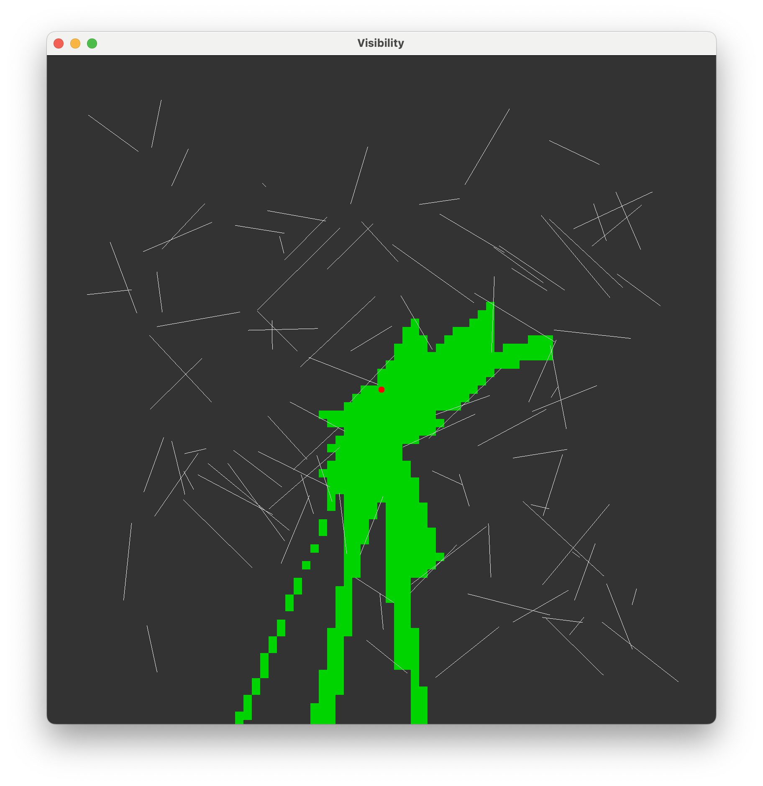
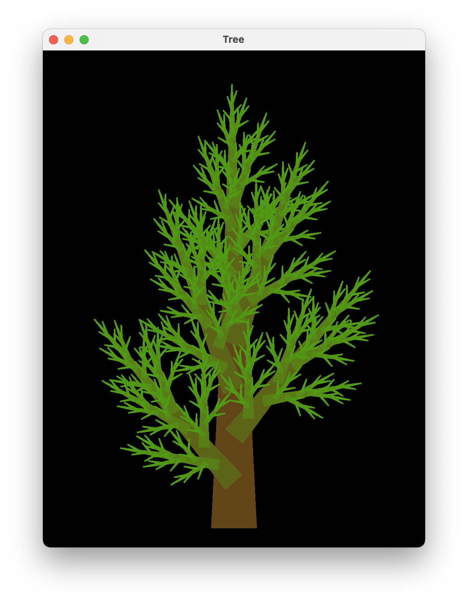
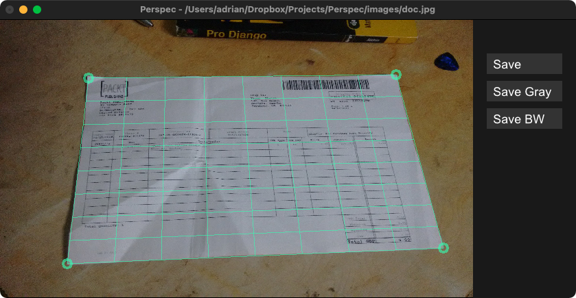

# Brillo

Brillo hides the pain of drawing simple vector graphics and raster images
behind a nice data type and a few display functions.

<table>
  <tr>
    <td>
      
    </td>
    <td>
      
    </td>
    <td>
      
    </td>
  </tr>
</table>


## Example

Getting something on the screen is as easy as:

```hs
import Brillo

main = display
  (InWindow "Nice Window" (200, 200) (10, 10))
  white
  (Circle 80)
```

Explore and run the [example projects](./brillo-examples/README.md)
with [stack](http://haskellstack.org):

```sh
stack run brillo-boids
```


## Usage

Once the window is open you can use the following:

- Quit
  - esc-key
- Move Viewport
  - arrow keys
  - left-click drag
- Zoom Viewport
  - page up/down-keys
  - control-left-click drag
  - right-click drag
  - mouse wheel
- Rotate Viewport
  - home/end-keys
  - alt-left-click drag
- Reset Viewport
  - 'r'-key


## More

- Animations and simulations can be constructed similarly
    using the `animate` and `simulate` functions
- Games with user input can be constructed with the `play` function.
- See the [brillo-examples](./brillo-examples/README.md) directory for more.


## Installation

### Running pre-built binaries

If you're running a pre-built binary on Linux,
install the required runtime libraries:

#### Debian / Ubuntu

```sh
sudo apt-get install libglu1-mesa libglfw3 libwebp7 \
  libxcursor1 libxi6 libxinerama1 libxrandr2 libxxf86vm1
```

#### Fedora

```sh
sudo dnf install mesa-libGLU glfw libwebp \
  libXcursor libXi libXinerama libXrandr libXxf86vm
```

#### Arch

```sh
sudo pacman -S glu glfw libwebp libxcursor libxi libxinerama libxrandr libxxf86vm
```

### Building from source

Install the development dependencies:

#### Debian / Ubuntu

```sh
sudo apt-get install libglfw3-dev libglu1-mesa-dev libwebp-dev \
  libxcursor-dev libxi-dev libxinerama-dev libxrandr-dev libxxf86vm-dev
```

#### Fedora

```sh
sudo dnf install glfw-devel libXxf86vm-devel
```

#### Arch

```sh
sudo pacman -S glfw libxxf86vm
```


## Contributing

Contributions are very welcome!

Please test that all the `brillo-examples` still work
before submitting your pull request.


## Releasing

1. Bump the `version` of every package that changed
    (and of packages whose dependency bounds must change)
    and update the bounds on the other Brillo packages accordingly.
    Breaking changes require a new major version (first component).
1. Rename the `Unreleased` section of the [CHANGELOG](./CHANGELOG.md)
    to `## YYYY-MM-DD - X.Y.Z` and update `brillo-export/ChangeLog.md`.
1. Check that `make test` passes.
1. Commit the changes as `vX.Y.Z`, tag the commit with `vX.Y.Z`,
    and push the commit and the tag.
1. Run `make release`, which
    - uploads all packages and their documentation to Hackage
    - creates the GitHub release "Brillo X.Y"
        with the changelog section of the version as release notes
        (also available separately as `make github-release`)


## History

This library is a fork of [gloss](https://github.com/benl23x5/gloss)
and improves upon it in several ways.
Check out the [CHANGELOG](./CHANGELOG.md) for more details.
